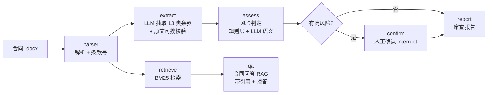

# 合同智能审查 Agent（Contract Review Agent）

> 一个前后端分离的合同审查平台：**上传合同 → 条款抽取 → 风险判定 → 人工确认 → 审查报告**，还带**基于合同的 AI 问答**和**合同对比**。

[](https://www.python.org/)
[](https://fastapi.tiangolo.com/)
[](LICENSE)

---

## 功能模块

| 模块 | 说明 |
|---|---|
| 🔍 **合同审查** | 上传 DOCX → 抽 13 类条款 → 风险判定（合规/偏离/缺失/冲突）→ 报告 |
| 💬 **AI 对话** | 基于合同原文的 RAG 问答，带条款引用，**能拒答**（防幻觉） |
| ⚖️ **合同对比** | 选两份合同 → 逐条比对差异（修改/新增/删除/相同） |
| 📊 **评估数据** | 31 份合同 / 403 条评估集，指标可复现 |
| 📖 **关于** | 项目介绍与技术说明 |

## 架构



## 亮点

- **评估驱动**：403 条人工评估集，所有数字可复现（`python scripts/evaluate.py`）
- **防幻觉**：抽取证据必须「原文可搜」；问答时合同里没有的信息会**直接拒答**
- **人工确认闭环**：高风险条款用 LangGraph `interrupt` 暂停，人批准后才进报告，支持断点续跑
- **四态风险判定**：不只判「有/无」，还能判「违约金超标 → 冲突」「责任上限合理 → 合规」
- **成本透明**：单份合同审查约 2 秒、成本约 1 分钱

## 快速开始

```bash
# 1) 装依赖
python -m venv .venv
.venv\Scripts\Activate.ps1          # Windows
pip install -r requirements.txt

# 2) 配置密钥
cp .env.example .env                # 填入 DEEPSEEK_API_KEY

# 3) 启动后端（同时托管前端）
python -m uvicorn api:app --host 127.0.0.1 --port 8000
```

浏览器打开 **http://127.0.0.1:8000** 即可使用全部模块。

也可以命令行跑：

```bash
python scripts/demo.py                        # 展示完整审查过程
python scripts/review.py 合同文件名.docx       # 审查任意合同
python scripts/evaluate.py                    # 跑评估，出分数表
```

### Docker

```bash
cp .env.example .env
docker compose up
```

## 评估结果（results/eval_v3.json，31 份合同 / 403 条）

| 层 | 指标 | 数值 |
|---|---|---|
| 条款抽取 | 准确率 | **95.53%** |
| | F1 | **92.57%**（precision 94.4% / recall 91.5%） |
| 风险判定 | verdict 准确率 | **91.07%** |
| | severity 准确率 | **94.54%** |
| 冲突判定（填充样本） | 准确率 | **100%**（4 处冲突全判对） |

> 说明：verdict 准确率（91.07%）仍略低于抽取（95.53%），是因为 gold 集的「偏离/缺失」是规则标注的，而语义判定更细（如「空白条款算缺失」），两者在边界上有分歧——这是**评估标准变严**，不是系统变差。
>
> **版本记录**：修复「条款正文只取到标题」的 bug 后，verdict 准确率 85.36% → **91.07%**、severity 88.34% → **94.54%**（详见 `docs/failures.md` 第 6 条）。

## 测试

```bash
python -m pytest        # 37 个用例，约 5 秒
```

覆盖范围（`tests/`）：

| 文件 | 覆盖 |
|---|---|
| `test_auth.py` | 注册 / 登录 / 禁用账号 / 修改密码 / 找回密码（安全问题、失败限次） |
| `test_permissions.py` | 未登录 401、普通用户访问管理端 403、管理员 200 |
| `test_reviews.py` | 记录隔离、详情权限、删除、健康检查、个人统计结构 |
| `test_compare_logic.py` | 对比逻辑的增/删/改/同判定 + 风险等级规则 |
| `test_templates.py` | 静态页、合同列表、模板列表 |

> 测试用**临时 SQLite**（`conftest.py` 里把 `DB_PATH` 指到临时目录），不会动 `data/app.db`；也不调用大模型。
> CI：`.github/workflows/tests.yml`，push 到 main 自动跑。

## 项目结构

```
contract-review-agent/
├── api.py          # FastAPI 后端（审查 / 对话 / 对比 / 评估 接口）
├── src/            # parser / extract / retrieve / assess / report / judge / qa / workflow
├── static/         # 前端：index.html + app.js + images/
├── scripts/        # demo.py / review.py / evaluate.py
├── data/
│   ├── raw/        # 31 份合同（市场监管总局示范文本库 + 填充示例）
│   ├── playbook/   # 13 类标准条款（must_contain / red_flags）
│   └── eval/       # gold.json 评估集（403 条）
├── docs/           # design.md / failures.md / interview.md
├── results/        # 版本化评估结果 eval_vN.json
├── Dockerfile / docker-compose.yml
└── config.py       # 唯一配置入口
```

## 已知局限（诚实记录）

- **适用范围**：13 类条款面向**商务合同**（买卖 / 租赁 / 承揽 / 服务 / 建设）；劳动合同、股权/投资合同等类型**不适用**——这些合同缺少「付款 / 交付 / 验收 / 发票」等条款是正常的，系统会误报「缺失」。要覆盖更多类型，需按合同类型切换 playbook；
- 大部分数据为**空白示范文本**，仅 2 份为填充示例；暂无大量「合规/冲突」真实样本；
- 风险判定的语义层依赖 LLM，成本略高于纯规则层；
- DOCX 页码为估算（靠显式分页符），非精确页码。

## 免责声明

本项目仅为技术演示，生成内容**不构成法律意见**，不替代律师或专业人士的审查。
