# 合同智能审查 Agent（Contract Review Agent）

> 上传合同 → 自动识别 **13 类核心条款** → **四态风险判定**（合规 / 偏离 / 缺失 / 冲突）→ 给出**可复制的修订建议**；
> 附带**锚定合同原文的 AI 问答**（能拒答）、**合同对比**、**管理端看板与运维**。

[](https://www.python.org/)
[](https://fastapi.tiangolo.com/)
[](https://vuejs.org/)
[](tests/)
[](.github/workflows/tests.yml)
[](LICENSE)

📄 [架构设计](docs/architecture.md) · 🎬 [5 分钟演示脚本](docs/DEMO.md) · 🐞 [错例库](docs/failures.md) · 🎤 [面试速记](docs/interview-cheatsheet.md)

---

## 目录

- [这是什么](#这是什么)
- [界面预览](#界面预览)
- [功能矩阵](#功能矩阵)
- [架构](#架构)
- [技术栈](#技术栈)
- [核心设计（为什么这么做）](#核心设计为什么这么做)
- [评测结果](#评测结果)
- [测试与 CI](#测试与-ci)
- [快速开始](#快速开始)
- [配置](#配置)
- [API 一览](#api-一览)
- [项目结构](#项目结构)
- [安全与边界](#安全与边界)
- [已知局限（诚实记录）](#已知局限诚实记录)
- [Roadmap](#roadmap)
- [数据来源与致谢](#数据来源与致谢)
- [License](#license)

---

## 这是什么

一个**前后端分离**的合同审查平台，面向**商务合同**的初审场景。

它解决的不是「让 AI 聊合同」，而是三件具体的事：

1. **该有的条款有没有** —— 13 类条款逐条检查，缺失也算风险
2. **有问题的条款错在哪** —— 引用条款号和原文，可核对
3. **该怎么改** —— 给出修订文本，可直接复制

> 定位是**初审辅助**，不替代律师；所有结论都标注依据，最终由人确认。

---

## 界面预览

> 截图来自线上部署：<https://contract-review-agent-s8f3.onrender.com>（免费实例，首次打开冷启动约 50 秒）

| 首页 | 合同审查 |
|---|---|
| 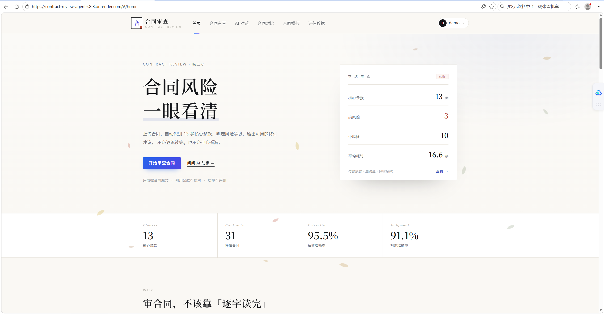 | 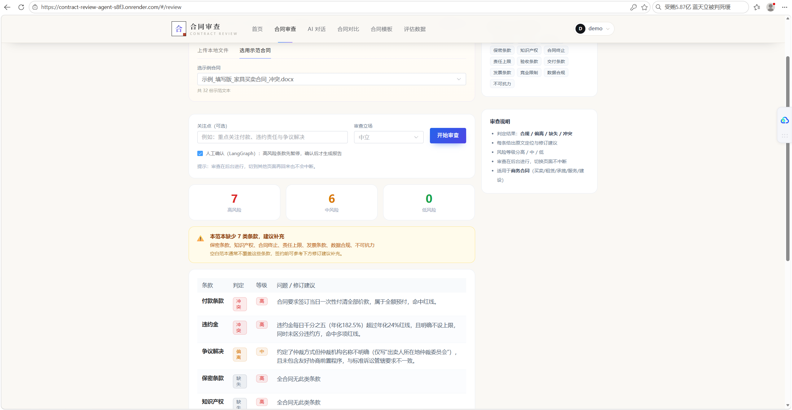 |

| AI 对话（可调工具 / 带引用） | 个人中心 · 概览 |
|---|---|
| 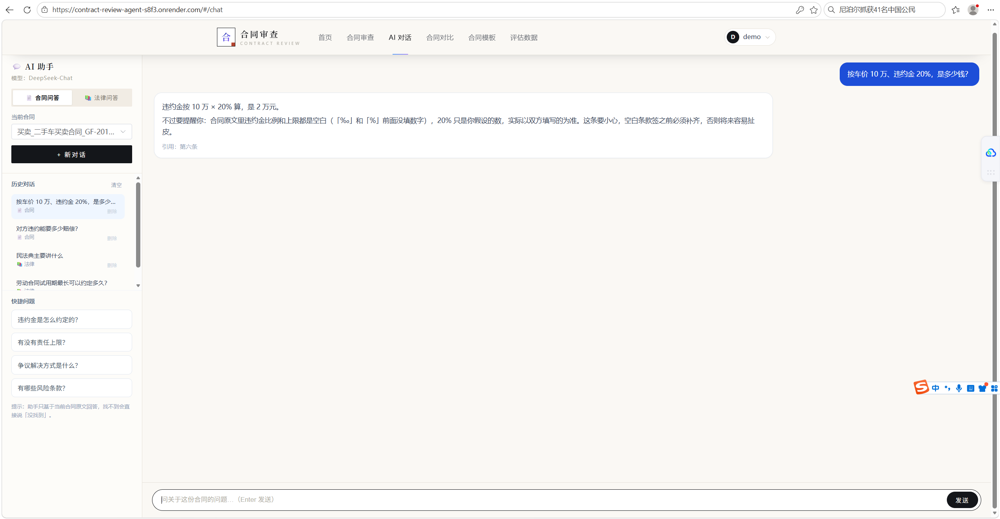 | 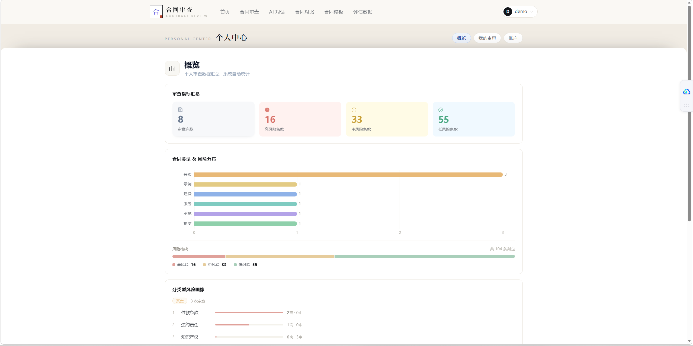 |

| 个人中心 · 分类型风险画像 | 管理端 · 系统看板 |
|---|---|
| 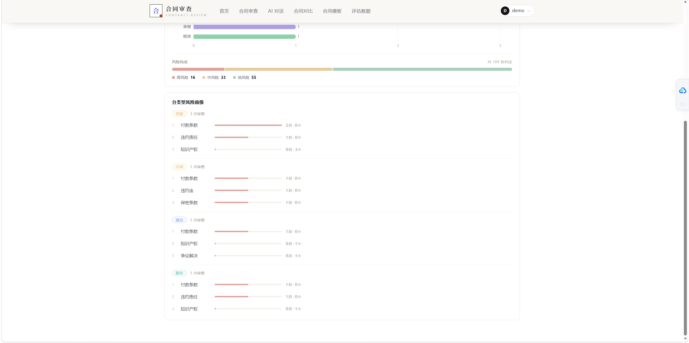 | 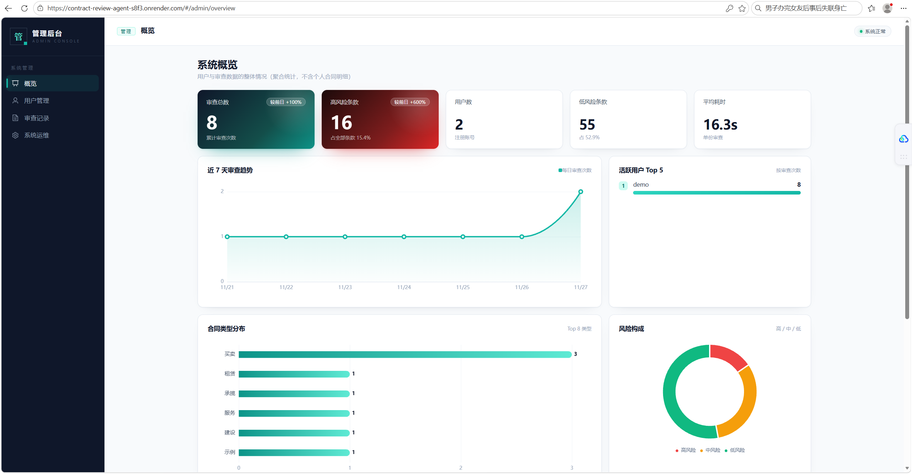 |

| 管理端 · 系统运维 | 登录页 |
|---|---|
| 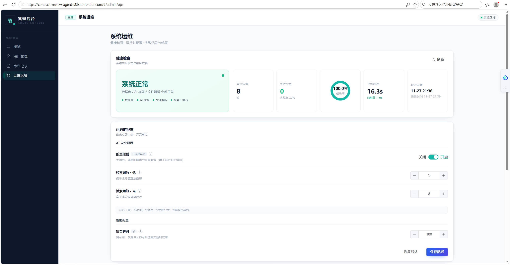 | 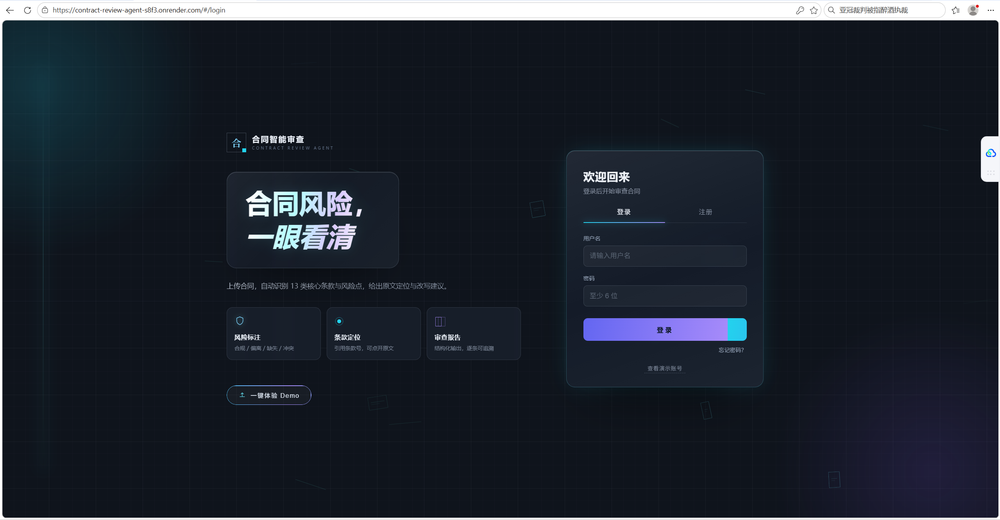 |

**合同模板库**（33 份示范文本，支持原样预览 DOCX、下载、上传自定义）：

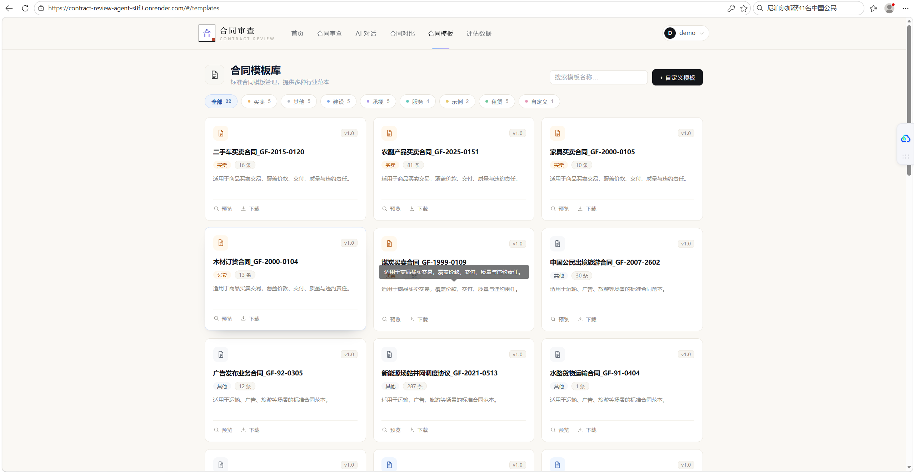

---

## 功能矩阵

### 用户端

| 模块 | 能力 |
|---|---|
| 🔍 **合同审查** | 上传 `.docx` 或选模板 → 四阶段进度 → 13 类条款判定 → 可复制修订建议；可选**人工确认**（高风险先暂停，确认后出报告） |
| 💬 **AI 对话** | 合同问答（RAG + **工具调用**，带条款引用、可拒答）/ 法律问答 / 历史会话 |
| ⚖️ **合同对比** | 双卡选择（样例或上传）→ 逐条 Diff → 统计看板 → 风险摘要 → 导出报告 |
| 📚 **合同模板** | 33 份示范文本，按类型筛选、预览（原样渲染 DOCX）、下载、上传自定义 |
| 📊 **评估数据** | 31 份 / 403 条金标指标、版本对比、前置拦截对比 |
| 🏠 **首页** | 产品优势、与「直接用 AI 聊天」的差异、前后对比、能力表 |

### 个人中心

| 模块 | 能力 |
|---|---|
| 📈 **概览** | 审查指标、合同类型分布（ECharts）、风险构成、按类型的风险画像 |
| 📋 **我的审查** | 多维度筛选、风险标签、分页、**报告详情页** |
| 👤 **账户** | 修改密码、设置安全问题、退出确认 |

### 管理端

| 模块 | 能力 |
|---|---|
| 📊 **看板** | 5 指标（核心指标渐变强调）、近 7 天趋势、类型分布、风险构成（ECharts） |
| 👥 **用户管理** | 搜索 / 角色筛选 / 新增 / 编辑 / 启用禁用 / 批量启停 / 重置密码 |
| 📋 **审查记录** | 多维度筛选、报告抽屉、批量删除、导出 CSV、查看原合同 |
| 🛠️ **系统运维** | 健康检查（服务依赖 + 环形成功率）、运行时配置、失败记录与重试、演示工具 |

---

## 架构

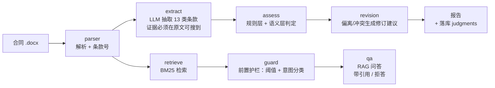

更细的分层图、时序图、护栏决策、数据模型见 **[docs/architecture.md](docs/architecture.md)**。

### 审查流水线（LangGraph 状态图）

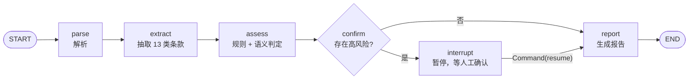

| 情况 | 行为 |
|---|---|
| 无高风险 | 一条直线跑完，直接出报告 |
| 有高风险 | 在 `confirm` 节点 `interrupt` 暂停 → 接口返回 `pending` + 高风险清单 → 人确认后 `Command(resume=...)` **从断点继续**，不重跑前面的 LLM 步骤 |
| 状态保存 | 由 checkpointer 持有（当前 `MemorySaver`，服务重启会丢，见[已知局限](#已知局限诚实记录)） |

对应接口：`POST /api/review_graph`、`POST /api/review_graph/resume`。

---

## 技术栈

| 层 | 选型 |
|---|---|
| **后端** | Python 3.12 · FastAPI · Uvicorn · SQLite（轻量迁移） |
| **前端** | Vue 3 · TypeScript · Vite · Pinia · Vue Router · Element Plus · ECharts · docx-preview |
| **AI** | DeepSeek（OpenAI 兼容 SDK）· **LangGraph**（审查编排 + interrupt 人工确认）· **工具调用**（function calling）· RAG（**BM25 + 向量混合检索 + Rerank**，可降级为纯 BM25）· 前置护栏 |
| **工程** | pytest（58 用例）· GitHub Actions · Docker 多阶段构建 · Render 部署 |

---

## 核心设计（为什么这么做）

| 设计 | 做法 | 为什么 |
|---|---|---|
| **防编造** | 抽取的 `evidence` 必须能在原文中搜到，否则丢弃 | 模型会「造」不存在的条款 |
| **四态判定** | 不止 有/无，还判「偏离 / 缺失 / 冲突」 | 「违约金超标」是冲突，不是简单的有或无 |
| **双层判定** | playbook 规则层 + LLM 语义层 | 规则稳定可解释，语义覆盖边界 |
| **问答拒答** | 检索最高分低于阈值 → 直接说没找到 | 宁可说不知道，也不猜 |
| **前置护栏** | 阈值 + 意图分类，越界不调模型 | 防越界回答，也省成本 |
| **可追溯** | 每条判定带 `clause_no` + 原文片段 | 结果要能被人工核对 |
| **可评测** | 403 条人工金标 + 可复跑脚本 | 没有数字就没有迭代方向 |
| **运行时配置** | 护栏开关 / 阈值 / 超时存 DB，改完即生效 | 调整策略不用重新部署 |
| **失败可重试** | 失败记录落库，管理端一键重试 | 大模型偶发超时是常态 |
| **人机协同** | LangGraph 把审查编成状态图，高风险在 `confirm` 节点 `interrupt` 暂停，人确认后 `Command(resume)` 恢复 | 高风险条款不该机器直接出结论 |
| **工具调用** | 问答里模型可主动调用 4 个只读工具（见下） | 算数、查法条、取精确原文，不该靠模型硬猜 |
| **混合检索** | BM25（关键词）+ 向量（bge-m3）双路召回 → RRF 融合 → rerank 精排 | 语义问法（"钱什么时候给我"）BM25 召不回，向量能；纯向量又会丢条款号精确匹配 |
| **可降级** | 没配 embedding key 时自动退回纯 BM25；接口失败也退回 | 增强功能不该成为单点故障 |

### 检索增强（可选）

```ini
EMBEDDING_API_KEY=sk-xxx            # 不填则自动退回纯 BM25
EMBEDDING_BASE_URL=https://api.siliconflow.cn/v1
EMBEDDING_MODEL=BAAI/bge-m3
RERANK_MODEL=BAAI/bge-reranker-v2-m3
```

| 机制 | 说明 |
|---|---|
| 混合召回 | BM25 top-k 与向量 top-k 各算一半，用 RRF 融合（`rrf_fuse`） |
| 精排 | rerank 对融合结果重排，取 top-5 进上下文 |
| 缓存 | 同一段文本只编码一次（进程内缓存），避免重复计费 |
| **护栏不受影响** | 护栏阈值是按 BM25 分数标定的，所以判断「要不要拒答」仍用纯 BM25 结果 |

### 问答工具集（function calling）

| 工具 | 作用 | 为什么需要 |
|---|---|---|
| `get_clause(clause_name)` | 按条款名取完整原文 | 检索排不到时，用户明确问某条要能精准定位 |
| `search_law(keyword)` | 检索民法典等法条 | 「这样约定合法吗」必须引用真实条文 |
| `calc_penalty(amount, rate_percent / daily_rate, days)` | 算违约金 / 逾期利息 | **模型算数不可靠**，交给代码算 |
| `get_review_summary()` | 读最近一次审查结论 | 「哪条高风险」直接用结构化结果，不重新推理 |

> 实现：`src/tools.py`（工具定义 + 执行器）+ `src/qa.py`（最多 3 轮工具循环，支持流式下发 `tools` 事件）。
> 模型不支持 tool calling 时**自动退回普通 RAG**，不会 500。

---

## 评测结果

`results/eval_v3.json` — **31 份合同 / 403 条人工金标**

| 层 | 指标 | 数值 |
|---|---|---|
| 条款抽取 | 准确率 | **95.53%** |
| | F1 | **92.57%**（P 94.4% / R 91.5%） |
| 风险判定 | verdict 准确率 | **91.07%** |
| | severity 准确率 | **94.54%** |
| 冲突判定（填充样本） | 准确率 | **100%**（4/4） |

### 版本记录：修一个 bug，涨 5.7 个点

| 指标 | 修复前 | 修复后 | 变化 |
|---|---|---|---|
| 判定准确率 | 85.36% | **91.07%** | **+5.71%** |
| 严重度准确率 | 88.34% | **94.54%** | **+6.20%** |

> 原因：取条款正文时只取了标题行，标题后的正文段落没被收进来。修复后按「主条款边界」收集正文，并在目录重复时取最长的一条。
> 完整 rca 见 [docs/failures.md](docs/failures.md) 第 6 条；修复前后对比可在站内「评估数据」页查看。

### 复跑

```bash
python scripts/evaluate.py        # 输出上面这张表
```

---

### 检索消融（4 种策略对比）

```bash
python scripts/evaluate_retrieval.py
```

30 条金标（5 份合同，关键词型 + 口语语义型）+ 3 条库外问题：

| 策略 | Hit@1 | Hit@3 | Hit@5 | MRR@5 |
|---|---|---|---|---|
| 纯 BM25 | 40.0% | 63.3% | 70.0% | 0.515 |
| 纯向量（bge-m3） | 50.0% | 70.0% | 80.0% | 0.619 |
| 混合（RRF） | 46.7% | **80.0%** | 86.7% | 0.637 |
| **混合 + Rerank** | **63.3%** | **80.0%** | **86.7%** | **0.726** |

库外拒答：**3/3**（评测时强制开启护栏，跑完还原）

**结论**

| 发现 | 数据 |
|---|---|
| 向量补语义 | 混合让 Hit@3 从 63.3% → **80.0%**（+16.7pt） |
| Rerank 补精度 | Hit@1 从 46.7% → **63.3%**（+16.6pt），MRR 0.637 → **0.726** |
| 剩下 4 条漏检 | 都是空白示范文本（表格碎片），属数据问题，不是检索问题 |
| 成本 | 首次编码 148 段约 1.75s，之后走缓存 0.01s；每次问答约 +0.3s |

> 结论直接决定了现在的默认链路：**BM25 + 向量 RRF 融合 → Rerank**。

## 测试与 CI

```bash
python -m pytest        # 58 passed in ~5s
```

| 文件 | 覆盖 |
|---|---|
| `test_auth.py` | 注册 / 登录 / 禁用 / 改密 / 找回密码（安全问题、失败限次） |
| `test_permissions.py` | 未登录 401、普通用户访问管理端 403、管理员 200 |
| `test_reviews.py` | 记录隔离、详情越权、删除、健康检查、统计结构 |
| `test_compare_logic.py` | 对比的增/删/改/同判定 + 风险等级规则 |
| `test_tools.py` | 4 个问答工具（取条款 / 查法条 / 算金额 / 读结论） |
| `test_embed.py` | 向量检索降级、双路融合排序、编码失败退回 BM25 |
| `test_graph.py` | LangGraph 接口的越权 403 / 未知线程 404 / 未登录 401 |
| `test_templates.py` | 静态页、合同列表、模板列表 |

- 测试用**临时 SQLite**（`conftest.py` 重定向 `DB_PATH`），不碰 `data/app.db`，也不调用大模型
- CI：[`.github/workflows/tests.yml`](.github/workflows/tests.yml)，push 到 main 自动跑

---

## 快速开始

### 方式一：本地 venv（推荐）

```bash
python -m venv .venv
.venv\Scripts\Activate.ps1        # Windows
# source .venv/bin/activate       # macOS / Linux

pip install -r requirements.txt
cp .env.example .env              # 填入 DEEPSEEK_API_KEY

python -m uvicorn api:app --host 127.0.0.1 --port 8000
```

打开 **http://127.0.0.1:8000**，用 `admin / admin123` 登录。

### 方式二：Docker

```bash
cp .env.example .env
docker compose up
```

### 方式三：一键体验

登录页点「**一键体验 Demo**」，或直接点「查看演示账号」查看可用账号。

### 命令行

```bash
python scripts/demo.py                     # 完整审查过程演示
python scripts/review.py 合同.docx         # 审查任意合同
python scripts/evaluate.py                 # 跑评测出分数
python scripts/seed_demo.py                # 造演示数据
```

---

## 配置

| 变量 | 必填 | 说明 |
|---|---|---|
| `DEEPSEEK_API_KEY` | ✅ | 大模型密钥 |
| `DEEPSEEK_BASE_URL` | | 默认 `https://api.deepseek.com` |
| `MODEL` | | 默认 `deepseek-chat` |
| `EMBEDDING_API_KEY` / `EMBEDDING_BASE_URL` | | 可选，用 API 向量服务时填 |

**运行时配置**（无需重启，管理端 → 系统运维）：

| 配置 | 默认 | 说明 |
|---|---|---|
| `guard_on` | 开启 | 前置拦截开关（关闭可用来越界对比） |
| `guard_low` | 5.0 | 检索分数低于此值直接拒答 |
| `guard_high` | 8.0 | 高于此值直接放行；灰区走意图分类 |
| `review_timeout` | 180s | 单份审查超时（改成 0.5s 可制造真实故障） |

---

## API 一览

<details>
<summary>展开全部接口（40 个）</summary>

**认证**
| 方法 | 路径 | 说明 |
|---|---|---|
| POST | `/api/auth/register` | 注册（可选安全问题） |
| POST | `/api/auth/login` | 登录（禁用账号返回 403） |
| POST | `/api/auth/logout` | 退出 |
| GET | `/api/auth/me` | 当前用户（含 `has_security_question`） |
| POST | `/api/auth/change-password` | 修改密码（校验旧密码） |
| POST | `/api/auth/forgot/question` | 找回密码：取安全问题 |
| POST | `/api/auth/forgot/reset` | 找回密码：校验答案并重置（限次） |
| POST | `/api/auth/security-question` | 补设安全问题 |

**审查 / 对话 / 对比**
| 方法 | 路径 | 说明 |
|---|---|---|
| POST | `/api/review` | 上传合同审查 |
| POST | `/api/review_sample` | 审查示例合同 |
| POST | `/api/review_graph` | **LangGraph 编排审查**（高风险返回 pending） |
| POST | `/api/review_graph/resume` | **人工确认后恢复执行** |
| GET | `/api/contracts` | 示例合同列表 |
| GET | `/api/clause_text` | 取条款原文 |
| GET | `/api/contract_text` | 取合同原文（管理端） |
| POST | `/api/chat` · `/api/chat_stream` | 合同问答（普通 / SSE） |
| POST | `/api/law_chat` · `/api/law_chat_stream` | 法律问答 |
| POST | `/api/compare` | 对比两份样例合同 |
| POST | `/api/compare_upload` | 对比（支持上传混合） |

**个人中心**
| 方法 | 路径 | 说明 |
|---|---|---|
| GET | `/api/reviews` | 我的审查记录（管理员看全部） |
| GET | `/api/reviews/{id}` | 单条详情（含判定明细） |
| GET/PUT | `/api/me/preferences` | 审查偏好 |
| GET | `/api/me/stats` | 个人统计 + 分类型画像 |

**模板 / 评估**
| 方法 | 路径 | 说明 |
|---|---|---|
| GET | `/api/templates` | 模板列表 |
| GET | `/api/templates/preview` | 模板大纲 |
| GET | `/api/templates/download` | 下载 .docx |
| POST | `/api/templates/upload` | 上传自定义模板 |
| GET | `/api/eval` | 评测数据（summary / before / cases / qa_cases） |

**管理端**
| 方法 | 路径 | 说明 |
|---|---|---|
| GET | `/api/admin/stats` | 聚合统计 |
| GET | `/api/admin/health` | 健康检查（含服务依赖） |
| GET | `/api/admin/failures` | 失败记录 |
| POST | `/api/admin/retry/{id}` | 重试失败记录 |
| GET/PUT | `/api/admin/settings` | 运行时配置 |
| POST | `/api/admin/settings/reset` | 恢复默认配置 |
| POST | `/api/admin/demo/failure` | 注入模拟故障（演示） |
| POST | `/api/admin/failures/clear` | 清理演示数据（保留真实） |
| GET/POST | `/api/admin/users` | 用户列表 / 新建 |
| PATCH | `/api/admin/users/{id}` | 编辑（角色 / 重置密码） |
| PATCH | `/api/admin/users/{id}/status` | 启用 / 禁用 |
| DELETE | `/api/admin/users/{id}` | 删除 |
| DELETE | `/api/reviews/{id}` | 删除审查记录 |

</details>

---

## 项目结构

```
contract-review-agent/
├── api.py                    # FastAPI 入口（40 个接口）
├── config.py                 # 唯一配置入口
├── src/
│   ├── parser.py             # DOCX 解析（段落 + 表格 + 条款号）
│   ├── extract.py            # LLM 抽取 13 类条款
│   ├── assess.py             # 规则 + 语义双层判定
│   ├── revision.py           # 修订建议生成
│   ├── retrieve.py           # BM25 检索
│   ├── guard.py              # 前置护栏
│   ├── qa.py / law_qa.py     # 合同问答 / 法律问答
│   ├── judge.py              # 冲突判定
│   ├── report.py             # 报告生成
│   ├── workflow.py           # 流水线编排
│   └── auth.py               # 用户 / 会话 / 审查记录 / 配置
├── frontend/                 # Vue 3 + TS + Vite
│   └── src/
│       ├── views/            # 首页/审查/对话/对比/模板/评估/关于
│       ├── views/admin/      # 看板 / 用户 / 记录 / 运维
│       ├── views/me/         # 概览 / 我的审查 / 报告详情 / 账户
│       ├── layouts/          # 用户端顶栏 / 管理端侧栏
│       ├── components/       # 页脚 / 粒子 / 落叶动效
│       └── stores/           # user / review / compare
├── data/
│   ├── raw/                  # 33 份合同（示范文本 + 填充示例 + 自定义）
│   ├── playbook/             # 13 类标准条款（must_contain / red_flags）
│   ├── knowledge/            # 法条知识库
│   └── eval/                 # 403 条金标
├── docs/
│   ├── architecture.md       # 架构与关键设计（mermaid）
│   ├── DEMO.md               # 5 分钟演示脚本
│   ├── failures.md           # 错例库（6 个真实 bug）
│   ├── design.md             # 设计过程
│   └── interview-cheatsheet.md
├── tests/                    # 37 个 pytest 用例
├── scripts/                  # demo / review / evaluate / seed_demo
├── results/                  # 版本化评测结果
├── .github/workflows/        # CI
├── Dockerfile / docker-compose.yml
└── pytest.ini
```

---

## 安全与边界

| 项 | 做法 |
|---|---|
| 密码 | PBKDF2-SHA256（20 万次迭代），不存明文 |
| 安全问题答案 | 同样 PBKDF2 哈希，比对时忽略大小写 |
| 找回密码 | 同一用户名 10 分钟最多 5 次，超出锁定 |
| 会话 | token 存 SQLite，禁用账号 / 重置密码时**清空全部会话** |
| 权限 | 普通用户访问管理端一律 403；管理员不能删除/禁用自己，也不能删最后一个管理员 |
| 路径穿越 | 文件名取 `Path(name).name`，并校验必须落在 `data/raw` 内 |
| 越界提问 | 前置护栏拦截，不调用大模型 |
| 密钥 | `.env` 在 `.gitignore` 中，仓库不含任何密钥 |

---

## 已知局限（诚实记录）

- **适用范围**：13 类条款面向**商务合同**（买卖 / 租赁 / 承揽 / 服务 / 建设）；劳动合同、股权/投资合同**不适用**——这些合同缺少「付款/交付/验收/发票」是正常的，系统会误报「缺失」
- **样本**：多为空白示范文本，仅 2 份填充示例；缺少大量真实的「合规/冲突」样本
- **语义判定依赖 LLM**：成本高于纯规则层；模型波动会影响稳定性
- **审查是同步请求**（约 16 秒）：未做任务队列，高峰期易超时
- **API 无全局限流**：仅找回密码有失败限次，上生产需加按用户/IP 限流
- **SQLite 单机**：并发写有瓶颈，且容器重启数据会回滚
  - 缓解：检测到**空库**时会自动补 7 条演示审查记录（`demo` 账号），保证打开看板不是空白；真实数据写入后不再触发
- **页码为估算**：靠显式分页符推断，非精确页码
- **未做移动端专项适配**：只做了基础响应式

---

## Roadmap

| 优先级 | 事项 |
|---|---|
| P0 | 审查异步化（任务队列 + 轮询/SSE） |
| P0 | 线上演示数据与持久化存储（换 PostgreSQL） |
| P1 | API 全局限流（按用户 / IP） |
| P1 | 语料扩充：更多真实已填写的合同（当前多为空白示范文本） |
| P2 | 报告导出 PDF / Word |
| P2 | 移动端适配 |

---

## 数据来源与致谢

- 合同范本来自**国家市场监督管理总局**公布的示范文本（GF 系列），以及自建的填充示例
- 评测金标由人工标注，仅用于本项目评测
- 本项目为**技术演示**，不构成法律意见，不替代律师或专业人士

---

## License

[MIT](LICENSE)
