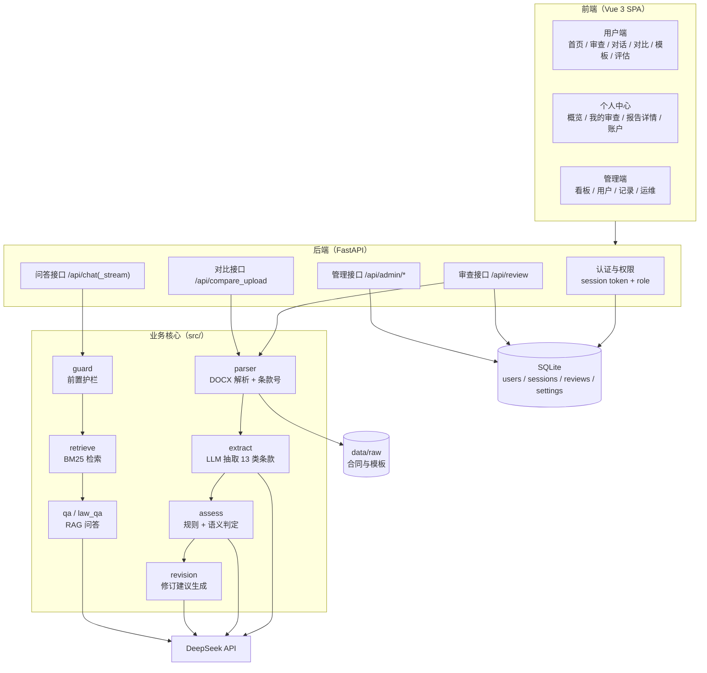
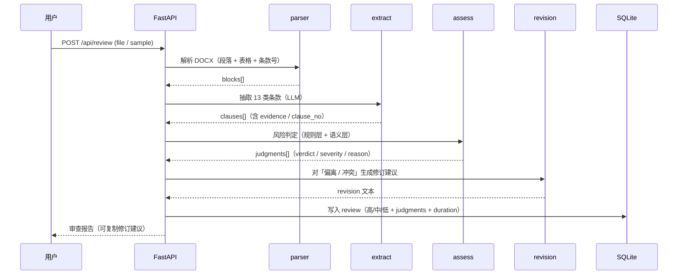
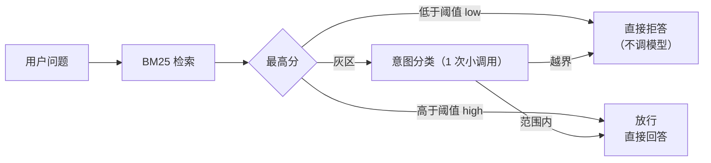
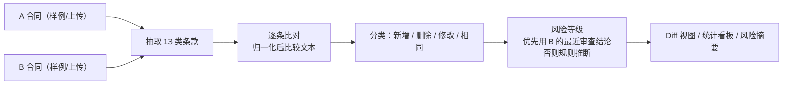
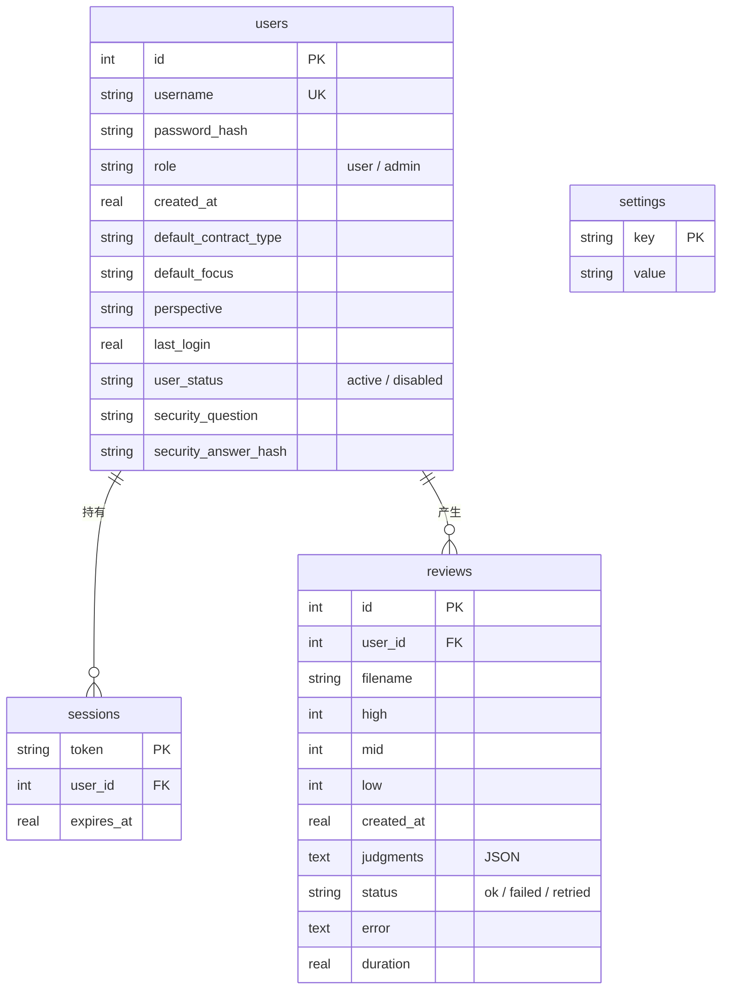
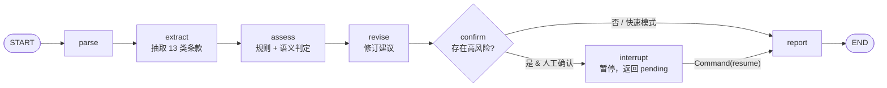

# 架构与关键设计

本文说明系统分层、审查流水线、护栏决策、对比流程、数据模型，以及几处「为什么这么设计」的取舍。

---

## 1. 系统分层

---

## 2. 审查流水线

**关键点**

| 环节 | 设计 | 为什么 |
|---|---|---|
| 解析 | 保留段落与表格结构，识别 `第X条` | 条款判定要能引用原文位置 |
| 抽取 | 要求 `evidence` 必须在原文中可搜到 | 防模型编造条款 |
| 判定 | 规则层（playbook 关键要素）+ 语义层 | 规则稳定、语义覆盖边界情况 |
| 修订 | 只对「偏离/冲突」生成 | 省钱，也避免无意义的改写 |
| 落库 | 存 `judgments` JSON | 报告详情、对话上下文都要用 |

---

## 3. 前置护栏（Guardrails）

- 阈值可在**管理端 → 系统运维**运行时调整（默认 5.0 / 8.0），改完立即生效
- 越界直接拒答，**不消耗大模型调用**
- 关闭开关可对比「有/无护栏」的差异（演示用）

---

## 4. 合同对比

**风险等级的来源是分层的**：B 合同若做过审查，用审查判定的 severity；没有则按规则推断（删除=高 / 修改=中 / 新增=低），并在界面上标注「规则推断」。

---

## 5. 数据模型

- **轻量迁移**：启动时用 `PRAGMA table_info` 检查缺列并 `ALTER TABLE ADD COLUMN`，老库可直接升级
- `settings` 存运行时配置（护栏开关、阈值、审查超时），管理员改完即生效

---

## 6. LangGraph 编排与人工确认

审查流水线除了顺序函数版本，还提供一条 **LangGraph 状态图**路径（`src/workflow.py`）：

**一张图，两条入口**（主链路就是它，不是"附加实现"）：

| 入口 | 模式 | 说明 |
|---|---|---|
| `POST /api/review` | 快速 | 传 `auto_confirm=true`，审查一口气跑完，行为与旧版一致 |
| `POST /api/review_graph` | 人工确认 | 有高风险时 `interrupt` 暂停，返回 `pending` + `thread_id` |
| `POST /api/review_graph/resume` | — | 传 `thread_id` + `action`（`approve`/`edit`）+ 可选 `changes` |

两条路径共用同一批节点，输出结构一致：`process`（段落数/条款数/耗时/tokens）、`overview`（高/中/低）、`judgments`（含 `revision`）。

**为什么需要它**

| 场景 | 顺序函数 | LangGraph |
|---|---|---|
| 高风险直接出报告 | 可以 | 可暂停等人确认 |
| 人确认后继续 | 只能整条重跑（重复耗 LLM） | `Command(resume)` **从断点继续** |
| 人修改判定 | 不支持 | 可用 `changes` 覆盖某条 verdict/severity 后再生成报告 |
| 多轮/长流程扩展 | 需要自己写状态机 | 加节点即可 |

**接口**

| 方法 | 路径 | 说明 |
|---|---|---|
| POST | `/api/review_graph` | 启动；支持示例合同（`name`）或上传（`file`）；有高风险返回 `status=pending` + `thread_id` + 高风险清单 |
| POST | `/api/review_graph/resume` | 传 `thread_id` + `action`（`approve`/`edit`）+ 可选 `changes`，恢复执行 |

**两个实现细节（踩过坑）**

1. **`Command(resume={})` 传空字典会被当成"没有恢复值"**，图会一直卡在 interrupt。所以确认参数统一成结构化对象 `{action, changes}`，永远非空。
2. **状态存在 checkpointer 里**（当前 `MemorySaver`，进程内内存）：
   - 服务重启 / Render 休眠唤醒后，待确认任务会失效（点确认返回 404）
   - 多 worker 部署时，请求可能打到没有该状态的进程
   - 上生产应换 `SqliteSaver` / `PostgresSaver` 落库

---

## 7. 错误处理策略

| 场景 | 处理 |
|---|---|
| 文件解析失败 | 记录 `status=failed` + 错误信息，管理端可**重试** |
| 大模型超时 | 同上；超时时间可在运维页调整（演示可改成 0.5s 制造真实故障） |
| 问答检索不到 | **直接拒答**，不猜 |
| 分析中异常 | 前端提示，不写坏数据 |
| 账号被禁用 | 登录返回 403，并清空其全部会话 |

---

## 8. 几处取舍（面试常被问）

1. **为什么不直接用大模型聊天审合同？**
   → 聊天模型会编、无定位、不可评测。所以做成「抽取 → 判定 → 修订」的流水线，每步可验证。

2. **为什么用 BM25 而不是纯向量？**
   → 合同问答里条款名、数字是强关键词，BM25 对「第X条」「30%」这类精确匹配更稳，也省掉了 embedding 服务依赖。

3. **为什么 SQLite？**
   → 单实例演示足够，零运维；上生产会换 PostgreSQL，代码层只需替换数据访问实现。

4. **为什么审核是同步请求？**
   → 单份约 16 秒，同步实现简单、前端可显示阶段进度；上生产会改任务队列（异步 + 轮询/SSE）。

5. **评测数字怎么来的？**
   → 31 份合同 / 403 条人工金标，脚本 `scripts/evaluate.py` 可复跑；每次改动用例都有前后对比（见 `docs/failures.md`）。
